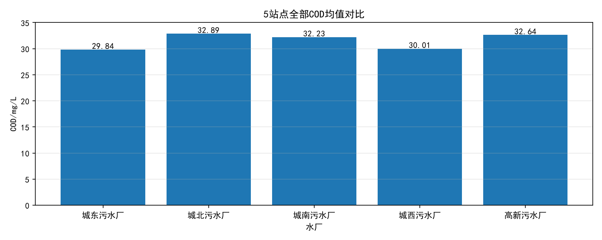

# 城市污水处理厂水质监测数据分析与预警系统

基于 MySQL + Python 的水质数据全流程分析项目，覆盖数据生成、入库、清洗、统计、可视化。

---

## 项目背景

某城市 5 座污水处理厂，每天采集 8 项水质指标（COD、BOD5、氨氮、总磷、总氮、pH、浊度、溶解氧）。

原先靠 Excel 手工统计，存在**数据分散、异常发现滞后、报表重复劳动**三大问题。

本项目搭建了从**数据入库 → 清洗 → 分析 → 可视化**的完整数据流程。

---

## 技术栈

| 层次 | 技术 |
|------|------|
| 数据库 | MySQL 8.0 |
| 数据处理 | Python、Pandas、NumPy |
| 可视化 | Matplotlib、pyecharts |
| 数据库连接 | PyMySQL |
| 开发环境 | VS Code |

---

## 项目结构

```
water-quality-analysis/
├── sql/
│   ├── schema.sql          # 建表 + 约束 + 索引
│   ├── init_data.sql       # 站点、指标字典初始化
│   └── queries.sql         # 分析查询
├── src/
│   ├── generate_data.py    # 生成数据 + 入库
│   ├── clean_analyze.py    # 清洗 + 分析
│   ├── visualize.py        # Matplotlib 出图
│   ├── chart.py            # pyecharts 出图
│   └── output/             # 图表输出
├── requirements.txt
├── .gitignore
└── README.md
```

---

## 数据库设计

4 张表：

| 表名 | 说明 |
|------|------|
| `site` | 站点表，5 个污水处理厂 |
| `indicator` | 指标字典表，8 项水质指标 |
| `water_quality` | 监测数据表 |
| `alarm_record` | 预警记录表 |

**核心约束**：
- 主键自增
- 外键关联
- `CHECK (value >= 0)` 保证数值非负
- `CHECK (alarm_level IN ('低','中','高'))` 限制预警等级
- 联合索引 `(site_id, indicator_id)` 加速查询

---

## 功能模块

### 1. 数据生成
- 按站点 × 指标 × 时间生成随机数据
- 不同指标按不同范围生成数值

### 2. 数据入库
- 批量插入，每 1000 条提交一次

### 3. 数据清洗
- IQR 异常检测
- 3σ 异常检测

### 4. 可视化
- 柱状图：5 站点 COD 均值对比
- 箱线图：各站点 COD 分布
- 折线图：城北 COD 月均值 + 阈值线

---

## 核心分析结论

- **城北污水处理厂** COD 均值最高
- COD 是最容易超标的指标
- 各站点 COD 均值在 29~33 mg/L 之间

---

## 图表预览




---

## 运行方式

### 1. 环境准备

```bash
pip install -r requirements.txt
```

### 2. 配置数据库

修改 `src/generate_data.py` 里的数据库连接信息：

```python
conn = pymysql.connect(
    host='localhost',
    port=3306,
    user='root',
    password='your_password',   # 改成你自己的密码
    database='water_monitor',
    charset='utf8mb4'
)
```

### 3. 建库建表

```bash
mysql -u root -p < sql/schema.sql
mysql -u root -p < sql/init_data.sql
```

### 4. 生成数据

```bash
cd src
python generate_data.py
```

### 5. 清洗分析

```bash
python clean_analyze.py
```

### 6. 生成图表

```bash
python visualize.py
python chart.py
```

---

## 作者

你的名字 | 2594236411@qq.com | [GitHub](https://github.com/你的用户名)